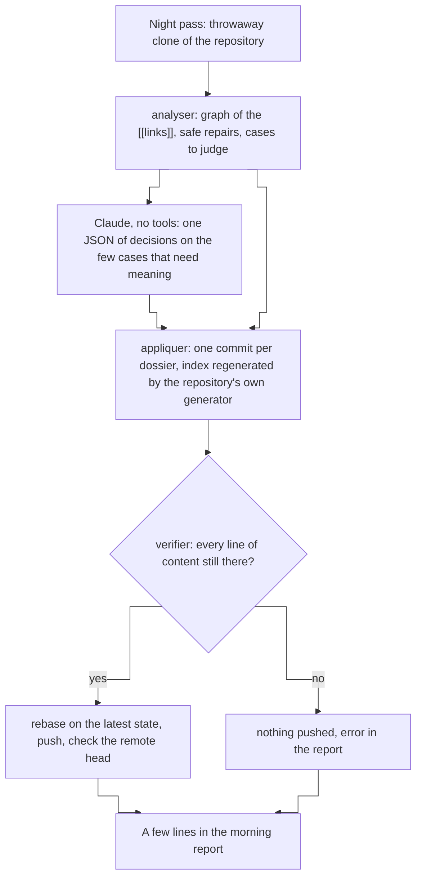

# Agent - Jardinier des dossiers

Every night, it tends a git repository of Markdown dossiers as a graph: reciprocal links, repaired links, no isolated dossier, duplicates merged without losing a line, stale dossiers closed. Then it writes a few lines in the morning report.



**English** · [Français](#version-française)

## What it does

The repository it tends holds one file per subject, `topics/<slug>.md`, with a YAML header (`slug`, `status`, `updated`, `aliases`, `links`) and sections such as `## État actuel`, `## Log`, `## Pending`, `## Notes`. Dossiers point to each other with `[[slug]]`.

- **Reciprocal links.** If A cites B (header or text), B gets `[[A]]` in its `links` header.
- **Broken links.** A link whose target is gone is repaired when the target is found without doubt: a redirection page, a renamed slug, an exact alias, the same name written with dashes. Otherwise Claude may pick one of the closest names; if nobody is sure, the link stays as it is and is listed in the report.
- **Unreadable headers.** A header that YAML cannot read because a value contains « : » gets that value quoted, character for character.
- **Isolated dossiers.** A dossier linked to nothing is linked, both ways, to the closest dossier, chosen by Claude from the whole catalogue.
- **Duplicates.** Pairs that look alike (text similarity, shared aliases) are shown to Claude; when it says they follow the same subject, the weaker one is merged into the other: its `Pending`, `RDV` and `Alarme` lines join the same sections (so tasks and calendar entries keep working), everything else goes in a dated note, its slug and aliases become aliases, and its file becomes a redirection page in `archives/redirections/` (plus an entry in the `RENOMMES` table of `scripts/normaliser.py` when the repository has one). Never more than 3 merges a night.
- **Stale dossiers.** Active dossiers with no activity for 60 days (newest date among `updated` and the dates written in the file) and nothing planned are shown to Claude; when it says the subject is over, the status becomes `done`, with a line in the `Log`. Nothing is ever deleted. Never more than 5 a night.
- **Index.** The repository's own generator (`scripts/gen-index.py`) is run; the index is committed only if git tracks it.

Claude never edits a file. It gets a short list of candidates with excerpts, returns decisions in JSON, and the program keeps only decisions about the candidates it proposed.

## Nothing lost, nothing forced

- Work happens in a throwaway clone, deleted at the end; the user's working copy is never touched.
- **One commit per dossier**, titled « Subject : what changed », so that a repository guard that refuses mixed commits accepts them, and so that `git log -- topics/<slug>.md` still tells the story of one dossier.
- Before any push, `verifier` checks that **every line of content** of every touched file at the start still exists somewhere in the repository, and that every alias is still carried. One missing line and nothing is pushed.
- If the repository moved during the pass, it rebases; on a conflict it starts again from a fresh clone (3 tries), then gives up until the next night.
- After the push, it reads the remote head to confirm.
- The report gives the `git revert` range of the night.

## The morning report

```
12 commit(s) poussé(s) dans le dépôt des dossiers, aucun contenu perdu (contrôle ligne à ligne).
• Liens réciproques : 14 ajoutés dans 9 dossiers.
• Liens cassés réparés : 2 (project-garden → project_garden, old_bike → project_bike).
• Isolé relié : reference_printer ↔ project_home_office (the printer belongs to the home office).
• Classé clos : project_bike (bike given away, nothing left to do).
• Avis de Claude : the graph is dense; most candidates are neighbours, not duplicates.
Retour arrière : git revert 1a2b3c4d..5e6f7a8b (dans le dépôt des dossiers).
```

Words listed in `donnees/masquer.local` are never shown in the report (a dossier whose name matches becomes « un projet perso »).

## Use

```
python3 jardinier.py analyser REPO analysis.json      # read only: graph, safe repairs, cases to judge
./lancer.sh essai                                     # full pass on a clone, no push, no report; clone kept in donnees/essai/
SANS_CLAUDE=1 ./lancer.sh essai                       # same, without Claude (safe repairs only)
./lancer.sh nuit                                      # the night pass (from cron, at the hours of HEURES)
python3 -m unittest tests/test_jardinier.py           # tests on a small fictional repository
```

Settings live outside the repository, in `donnees/lancer.local` (shell variables): `DEPOT` (git address of the dossiers repository), `DEPOSER` (command that files the section of the morning report), `COMPTE_CMD`, `JETON_FICHIER`, `CONFIG_CLAUDE`, `CLAUDE_CMD`, `MODELE`, `EFFORT`, `LOURD` (prefix for heavy steps, e.g. a CPU-capped wrapper), `HEURES`, `MAX_FUSIONS`, `MAX_CLOS`. Requirements: Python 3 with PyYAML, git, [Claude Code](https://docs.claude.com/en/docs/claude-code) for the judgment pass.

---

## Version française

Chaque nuit, il entretient un dépôt git de dossiers Markdown comme un graphe : liens réciproques, liens réparés, aucun dossier isolé, doublons fusionnés sans perdre une ligne, dossiers périmés classés clos. Puis il écrit quelques lignes dans le rapport du matin.

- **Liens réciproques** : si A cite B, B reçoit `[[A]]` dans son en-tête `links`.
- **Liens cassés** : réparés quand la cible se retrouve sans doute (page de redirection, ancien nom, alias exact, tirets au lieu de soulignés) ; sinon Claude peut choisir parmi les noms proches ; dans le doute, le lien reste et il est signalé.
- **En-têtes illisibles** : une valeur contenant « : » est mise entre guillemets, sans changer un caractère.
- **Dossiers isolés** : reliés dans les deux sens au dossier le plus proche, choisi par Claude dans tout le catalogue.
- **Doublons** : quand Claude dit que deux dossiers suivent le même sujet, l'un est fusionné dans l'autre : ses lignes `Pending`, `RDV`, `Alarme` rejoignent les mêmes sections (les tâches et l'agenda continuent de marcher), le reste va dans une note datée, son nom et ses alias deviennent des alias, son fichier devient une page de redirection dans `archives/redirections/`. Au plus 3 fusions par nuit.
- **Dossiers périmés** : actifs, sans activité depuis 60 jours, rien de prévu ; si Claude dit que le sujet est terminé, `status: done` et une ligne au `Log`. Rien n'est jamais effacé. Au plus 5 par nuit.
- **Index** : régénéré par le générateur du dépôt.

Claude ne modifie aucun fichier : il rend des décisions JSON sur une liste courte de candidats, le programme les applique. Un commit par dossier ; avant tout push, `verifier` contrôle que chaque ligne de contenu existe encore ; une seule ligne manquante et rien n'est poussé. Le rapport donne la commande de retour arrière de la nuit.
